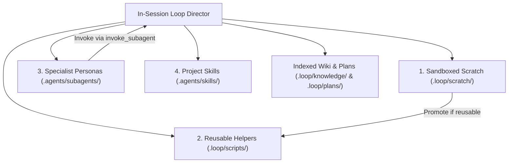

# Self-Evolution: Dynamic Capabilities and Deep Thinking Protocol

The autonomous loop is an **agnostic, self-evolving engineering engine**. It does not rely on
static scripts or rigid pre-configured assumptions. Given an open-ended directive — such as
`/loop "maximise profit of the application to reach max potential and realistic profit we can achieve"`
— the loop autonomously derives the system's objective function, establishes baseline metrics,
synthesizes tools and specialist agents on demand, and accumulates indexed knowledge to direct
its own next moves.

---

## 1. Agnostic Target Deconstruction

When activated with a high-level natural language target, the loop does not demand human
clarification or restrict itself to narrow, hardcoded evaluation slices unless strictly specified
by the user or project invariants.

Instead, the loop executes autonomous grounding:

```
1. Target Analysis   -- Parse intent: profit maximization, latency reduction, accuracy, throughput.
2. System Discovery  -- Inspect .loop/knowledge/index.md, config/ topologies, and CLI capabilities.
3. Metric Grounding  -- Identify the authoritative metric calculation pipeline and ground truth logs.
4. Frontier Mapping  -- Establish the gap between current baseline and theoretical potential.
5. Invariant Bounds  -- Identify hard boundaries: risk gates, budget caps, time-continuity, holdouts.
```

The resulting formal objective, success predicate, and bounds are recorded in
`.loop/knowledge/profile.yaml` and `.loop/loop.json`.

---

## 2. Just-In-Time Capability Synthesis

The loop manages its own capabilities dynamically across four distinct layers:



### A. Sandboxed Scratch Scripts (`.loop/scratch/`)
- **When to Use**: Quick diagnostic probes, one-off log parsers, matrix slices, or data verification.
- **Rules**:
  - Always created inside `.loop/scratch/` (never in the repository root, upholding INV-09 and AP-TOKEN-01).
  - Must produce byte-bounded outputs (≤ 2,500 bytes) or write summary JSON artifacts.
  - Can be deleted or archived once findings are compounded into `.loop/journal.jsonl`.

### B. Project Helper Scripts (`.loop/scripts/`)
- **When to Use**: When a scratch routine is reused across multiple iterations (e.g. custom receipt comparator, batch validator).
- **Rules**:
  - Promoted from `.loop/scratch/` with clear CLI argument parsing and zero external dependencies.
  - Documented in `.loop/knowledge/capabilities.md`.

### C. Specialist Agent Personas (`.agents/subagents/`)
- **When to Use**: When deep, multi-file exploration or heavy log analysis would contaminate the main director's context window.
- **Rules**:
  - Defined declaratively in `.agents/subagents/<persona>.yaml`.
  - Air-gapped and strictly read-only: specialists cannot edit code or stage git commits.
  - Invoked via `invoke_subagent` to perform causal diagnosis, returning compact summaries (≤ 2,500 bytes with exact line references).

### D. Custom Project Skills (`.agents/skills/`)
- **When to Use**: When a repeated multi-step workflow emerges (e.g. formal security audit, migration protocol).
- **Rules**: Packaged with a standard `SKILL.md` and reference documents for native host discovery.

---

## 3. Sequential Deep Thinking Cycle

The loop operates through deliberate, sequential thought. It avoids erratic sweeps, blind parameter
fuzzing, or unmeasured code edits. Every move follows a 5-phase cognitive discipline:

1. **Sense & Orient**:
   - Read `.loop/loop.json` and `.loop/plans/next_moves.json`.
   - Check `.loop/STOP` sentinel.
   - Orient through `.loop/knowledge/index.md` without loading unrelated files.
2. **Causal Gap Diagnosis**:
   - Localize the single dominant opportunity gap using diagnostic tools or specialized subagents.
   - Formulate a single, falsifiable hypothesis with explicit success/failure criteria.
3. **Surgical Candidate Formulation**:
   - Write the minimal code or configuration diff required to test the hypothesis.
   - Stage and commit a pre-evaluation snapshot (`feat(candidate): ...`) to lock provenance.
4. **Dual-Gate Verification**:
   - **Gate A (Primary Metric Gain)**: Candidate must outperform the incumbent on the target metric.
   - **Gate B (Invariant Soundness)**: Candidate must cause zero regressions on project invariants, unit tests, or boundary limits.
5. **Knowledge Compounding & Plan Evolution**:
   - Record the outcome in `.loop/journal.jsonl`.
   - Update `.loop/coverage.json` and `.loop/issues.jsonl`.
   - Update `.loop/knowledge/` topic leaves.
   - Update `.loop/plans/master_plan.md` and re-rank `.loop/plans/next_moves.json`.

---

## 4. Indexed Memory & Token Frugality

To ensure the loop can run endlessly across dozens or hundreds of iterations without context degradation:

- **Index-First Navigation**: The Map of Content (`.loop/knowledge/index.md`) stays strictly bounded under 2,048 bytes (< 400 tokens). Agents read the index first and open only the specific topic leaf needed.
- **Bounded Projections**: Evaluator and tool outputs are capped at ≤ 2,500 bytes. Multi-megabyte raw logs are digested by subagents or piped to summary JSON.
- **Append-Only Auditing**: Decisions and lessons are persisted to disk in append-only files rather than retained in conversational history.

---

## See Also
- [In-Session Loop](in-session-loop.md)
- [Agent Ecosystem](agent-ecosystem.md)
- [Token Economy](token-economy.md)
- [Graceful Control](graceful-control.md)
- [Loop Protocol](loop-protocol.md)
